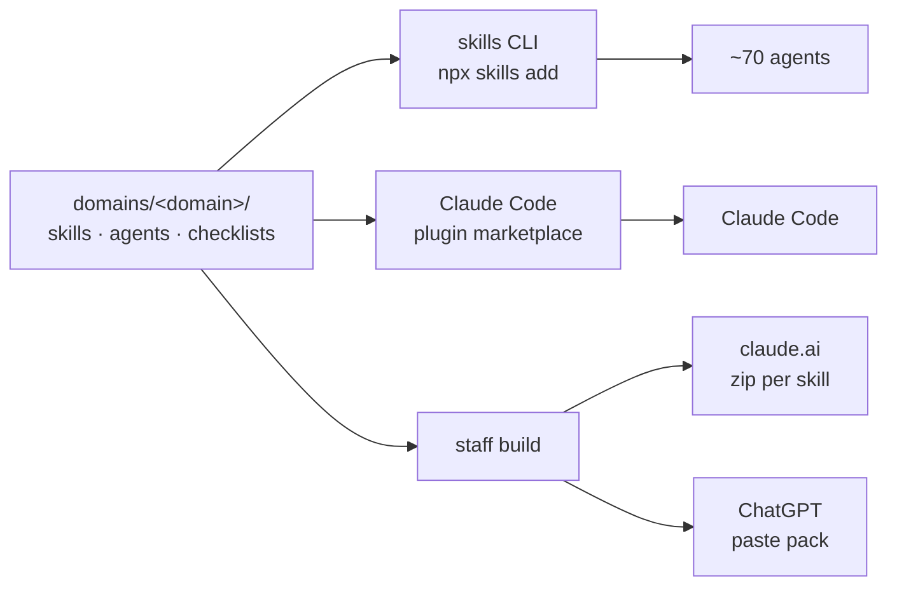

# my-staff

A versioned toolkit of agent skills, roles and checklists — for engineering, for product, and
for the rest of life. One source, every platform.

[](https://github.com/jeremiedrazic/my-staff/actions/workflows/ci.yml)
[](LICENSE)

In English, *staff* means two things at once: the stick you lean on, and the people who work
for you. This repository is both — a set of roles that do the work, and something to lean on
while doing it.

<!-- staff:stats -->
**2** skills · **0** roles · **2** checklists · **0** of 2 domains ready
<!-- /staff:stats -->

## Install

Pick a channel. All three read this repository; nothing is generated by hand.

```bash
# ~70 agents — Claude Code, Codex, Cursor, Copilot, Gemini CLI, Windsurf…
npx skills add jeremiedrazic/my-staff                 # add -g for every project
npx skills add jeremiedrazic/my-staff --skill write-a-skill

# Claude Code, as plugins, updated from the marketplace
claude plugin marketplace add jeremiedrazic/my-staff
claude plugin install ai-craft@my-staff

# claude.ai and ChatGPT, which have no filesystem to install into
pnpm staff build claude-ai     # a zip per skill, ready to upload under Settings → Skills
pnpm staff build chatgpt       # a paste-ready pack per domain, for a Project's instructions
```

An agent that lands here equips itself: the `install-from-my-staff` skill hands it the exact
command for the platform it is running on.

## Domains

A domain is a subject, and the unit you install. Only `ready` domains are worth installing;
`draft` ones are visible on purpose, because a toolkit that hides its unfinished parts is
lying about what it is.

<!-- staff:domains -->
### Meta

| Domain | What it covers | Skills | Roles | Status |
| :- | :- | -: | -: | :- |
| `ai-craft` | Building the tooling itself: writing a skill, a role or an eval, auditing one, and making it work on every platform. | 1 | 0 | `draft` |

### Engineering

| Domain | What it covers | Skills | Roles | Status |
| :- | :- | -: | -: | :- |
| `craft` | The disciplines a change passes through whoever makes it: how work is delegated, how it is reviewed, how a decision is recorded, and how a review finding becomes a lint rule. | 1 | 0 | `draft` |
<!-- /staff:domains -->

## Roles

A role has one of three shapes, and the shape is not a label — it is the `tools:` list.
A **builder** is handed a task and owns it. A **reviewer** reads and reports, and cannot
edit, which is what makes its report worth reading. An **advisor** helps decide and produces
nothing.

<!-- staff:roles -->
_No role yet._
<!-- /staff:roles -->

## How it works

One authored source. Each domain directory is, at the same time, a valid Claude Code plugin,
a portable OpenAI plugin, and a package the `skills` CLI can install — so three of the four
channels need no build at all.



`staff build` exists for one reason: a claude.ai upload accepts only six frontmatter keys and
fails outright on any other, so the zip it produces is stripped and verified. Everything else
reads the files as authored.

## The three laws

1. **A rule outside the linter does not exist.** Anything a machine can check lives in
   `staff validate`, a lint rule or a hook. Prose is for what no script can see. An agent under
   pressure drops the rules that are written nowhere executable, first.
2. **A skill whose quality is only asserted in prose has no quality.** Every skill in a `ready`
   domain carries at least one eval case, and the validator refuses the domain otherwise.
3. **Every criterion traces to an incident or a check.** Each domain keeps `field-notes.md`:
   what broke, why nothing caught it, and the rule that came out of it. A checklist of
   speculations gets ignored.

## The tooling

`staff` only does what no existing tool does — validate, generate the manifests, keep the
checklist copies honest, and build for the two platforms that cannot install from a repository.

```bash
pnpm staff list        # what is here
pnpm staff validate    # schemas, frontmatter, token budgets, links, evals
pnpm staff doctor      # all of the above, plus privacy, safety and missing dependencies
pnpm staff new skill review-a-dockerfile --domain delivery
```

Every command takes `--json`, so an agent can read the output, and `--check`, which is what CI runs.

## Layout

```
domains/<domain>/
  domain.json          the one hand-written manifest; everything else is generated from it
  skills/<name>/       SKILL.md · references/ · evals/
  checklists/<name>/   split by section, so a skill loads only what it needs
  agents/<role>.md     builder, reviewer or advisor — read from the tools list
  field-notes.md       the incidents the checklists came from
shared/schemas/        what a domain, a skill and a role are allowed to contain
bin/staff.mjs · src/   the tooling, with its tests in tests/
docs/adr/              why the structure is the way it is
```

## Documentation

- [docs/architecture.md](docs/architecture.md) — the source, the channels, and why there is a build step
- [docs/platform-matrix.md](docs/platform-matrix.md) — what is verified on a machine, and what is taken from the documentation
- [docs/authoring-a-skill.md](docs/authoring-a-skill.md) — the short version of `ai-craft:write-a-skill`
- [docs/privacy.md](docs/privacy.md) — why the life domains contain methods and never data
- [docs/credits.md](docs/credits.md) — what was learned from whom, and under which licence
- [CONTRIBUTING.md](CONTRIBUTING.md) · [SECURITY.md](SECURITY.md) · [docs/adr/](docs/adr/)

## Licence

Apache-2.0. The external tools some domains delegate to keep their own licences and are never
vendored here — see [docs/credits.md](docs/credits.md).
