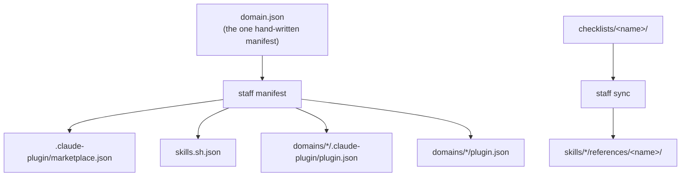

# Architecture

One authored source, four destinations, and as little machinery as the destinations allow.

## The shape

A domain directory is three things at once, with no duplication and no build step:

```
domains/ai-craft/
  .claude-plugin/plugin.json   → a Claude Code plugin
  plugin.json                  → a portable OpenAI plugin
  skills/<name>/SKILL.md       → read by both, and by the skills CLI
```

Nothing collides, because each runtime reads a different path and ignores keys it does not know.
The root `.claude-plugin/marketplace.json` serves two consumers: Claude Code, which installs
plugins from it, and the `skills` CLI, which also reads it. `skills.sh.json` names the skill
directories explicitly, so discovery never depends on how deep a directory happens to sit.



## Why there is a build step at all

Only for the two destinations that cannot read a repository.

**claude.ai** accepts exactly six frontmatter keys — `name`, `description`, `license`,
`compatibility`, `metadata`, `allowed-tools` — and fails the upload outright on any other.
`staff build claude-ai` strips the rest and refuses a skill whose *body* uses a Claude Code-only
feature without declaring it, because that failure is otherwise invisible: the skill uploads
cleanly and then quietly skips a step.

**ChatGPT**, outside Codex, has no filesystem to install into. `staff build chatgpt` renders one
paste-able pack per domain, and one per skill, each leading with the trigger so the model can
pick between them.

Everything else reads the files exactly as authored.

## Why a checklist is copied

A checklist is a document reviewed in a pull request, so it lives once at the domain level. It
also has to travel inside each skill that uses it, because a claude.ai zip and a `skills` CLI
install only carry the skill's own folder. Both facts are true, so the copy is generated:
`staff sync` writes it with a header naming its source, and `staff sync --check` fails the build
on a stale one. One canonical document, one mechanical guarantee, no hand-maintained duplicate.

## Why cross-domain reuse goes through skill names

A plugin installed from a marketplace is served from a cache, where it has no path to its
neighbours. So a reviewer in `backend` does not read `../../craft/contracts/reviewer.md`; it
says "load the `craft:reviewer-contract` skill first". The name is stable across every channel;
the path is not.

## Why a role's shape is its tools list

A contract written in prose at the top of a role file is a promise. A `tools:` list without
`Edit` is a fact. The validator reads the list, derives the shape, and refuses a role that does
not load the matching contract — so "a reviewer never edits" is enforced where it cannot be
forgotten. Same law as everywhere else here: a rule outside the linter does not exist.

## What `staff` deliberately does not do

It does not install anything. The `skills` CLI installs into about seventy agents and
`claude plugin` installs into Claude Code; writing a third installer would mean maintaining
seventy paths that someone else already maintains. `staff` validates, generates, and builds for
the two cases nobody covers.
